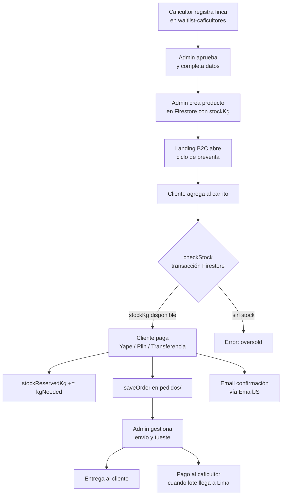
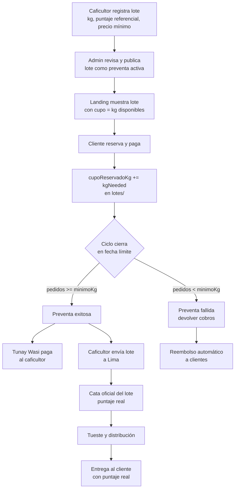

# Tunay Wasi — Modelo de Negocio: Actual vs. Propuesto

## Modelo Actual

### Resumen

Tunay Wasi opera hoy como **tostadora con stock propio**. El negocio compra o reserva lotes de café verde de caficultores, los tuesta y los vende en ciclos de preventa a clientes B2C. El riesgo de inventario recae sobre Tunay Wasi.

### Flujo actual



### Colecciones Firestore actuales

| Colección | Propósito | Campos clave |
|-----------|-----------|--------------|
| `caficultores/` | Registro y aprobación de productores | `status`, `puntajeSCA`, `stockKg` |
| `productos/` | Catálogo con stock y precios | `stockKg`, `stockReservedKg`, `weights[]`, `producerPct` |
| `pedidos/` | Órdenes de clientes | `adapter`, `items[]`, `totals`, `shipping` |
| `configurations/pricing` | Tiers SCA y precios al caficultor | `tiers[].caficultorPerKgCents` |
| `configurations/activeCycle` | Fechas del ciclo de preventa activo | `cicloCloseAt`, `deliverLima`, `deliverProv` |
| `waitlist-caficultores/` | Solicitudes de nuevos caficultores | `status: pendiente/aprobado` |

### Problemas del modelo actual

1. **Tunay Wasi asume el riesgo de stock** — compra o reserva café antes de tener pedidos confirmados.
2. **Puntaje SCA prometido puede variar** — el score mostrado en la landing es referencial, no de la cata oficial del lote en venta.
3. **Pago al caficultor desacoplado de la demanda** — se promete pago "al recepcionar el lote" independientemente de si hay pedidos suficientes.
4. **Un solo ciclo de preventa activo** — `configurations/activeCycle` asume un único ciclo global, no múltiples lotes en paralelo.
5. **Adaptadores de pago son mocks** — `niubizAdapter`, `yapeAdapter`, `plinAdapter` retornan `{ ok: true }` sin cobrar realmente.

---

## Modelo Propuesto: Marketplace de Microlotes Bajo Pedido

### Resumen

Tunay Wasi se convierte en **intermediario puro**: curaduría, tueste y logística. No stockea. El caficultor registra su lote disponible, Tunay Wasi abre una preventa con cupo limitado igual a los kg del lote, cobra a los clientes, y solo cuando la preventa cierra con éxito desembolsa al caficultor y coordina el envío.

### Flujo propuesto



### Cambios en Firestore

| Colección | Hoy | Propuesto |
|-----------|-----|-----------|
| `productos/` | `stockKg`, `stockReservedKg` | Reemplazar por `lotes/` |
| `lotes/` | No existe | Nueva colección central |
| `configurations/activeCycle` | Un ciclo global | Eliminado — cada lote tiene su propio ciclo |
| `pedidos/` | Sin referencia al lote | Agregar `loteId`, `cicloId` |
| `caficultores/` | Solo perfil | Agregar `lotesActivos[]` |

### Nueva colección `lotes/`

```typescript
interface LoteDoc {
  id: string
  caficultorId: string           // FK → caficultores/
  nombreLote: string             // "Bello Horizonte - Geisha Honey Lote 01-2026"

  // Calidad (referencial del caficultor, no oficial)
  puntajeReferencial: number     // 86.5
  puntajeOficial?: number        // se completa post-cata en Lima
  variedad: string
  proceso: string
  altitud: string
  cosecha: string                // "Junio 2026"

  // Stock y cupo
  kgDisponibles: number          // total ofertado por caficultor
  kgMinimoParaActivar: number    // mínimo para que el ciclo sea exitoso
  kgReservados: number           // incrementa con cada pedido

  // Ciclo de preventa
  preventa: {
    abreAt: string               // ISO — cuándo abre la preventa
    cierraAt: string             // ISO — cuándo cierra
    status: 'borrador' | 'activa' | 'exitosa' | 'fallida'
  }

  // Precios
  precioMinimoCaficultorCents: number   // lo que recibirá el caficultor
  weights: [WeightLabel, number][]      // precios al cliente final

  // Pago al caficultor
  pagoStatus: 'pendiente' | 'pagado'
  pagadoAt?: string
}
```

### Modelo de flete (B2B)

El flete **no es un costo de Tunay Wasi**. El caficultor despacha el saco desde origen y la cafetería paga el flete en destino (contraentrega al courier).

- `precioVentaPEN` = `precioOrigenPEN` + comisión 10% — flete NO incluido
- La cafetería ve claramente en el checkout: *"Flete a pagar en destino al courier"*
- `fletePEN` en `PedidoB2BDoc` es opcional y solo referencial — no entra en `totalPEN`

### Cambios en el checkout

| Aspecto | Hoy | Propuesto |
|---------|-----|-----------|
| Validación de stock | `checkStock` contra `stockKg` en `productos/` | `checkCupo` contra `kgDisponibles - kgReservados` en `lotes/` |
| Reserva | `stockReservedKg += kg` inmediato | `kgReservados += kg` + estado `reservado` hasta cierre del ciclo |
| Cobro | Inmediato al checkout | Inmediato (retener) — reembolso si ciclo falla |
| `saveOrder` | Guarda con `productoId` | Guarda con `loteId` + `cicloId` |
| Email al cliente | "Pedido recibido" | "Reserva confirmada — te avisamos cuando el ciclo cierre" |
| Flete | Incluido en total | Pago contraentrega al courier — no en total Tunay Wasi |

### Cambios en la landing B2C

| Elemento | Hoy | Propuesto |
|----------|-----|-----------|
| Card de producto | Stock en kg | Cupo restante + fecha de cierre |
| Puntaje SCA | Número fijo | "~86 pts (referencial)" con tooltip explicativo |
| CTA | "Agregar al carrito" | "Reservar este lote" |
| Preventa | Un contador global | Un contador por lote |
| Precio | Fijo por peso | Fijo por peso + "precio incluye S/X para el caficultor" |

### Lo que NO cambia

- Identidad visual y design system
- Flujo de shipping y cálculo de totales
- EmailJS para notificaciones
- Estructura de `caficultores/` (perfil del productor)
- Landing de caficultores B2B (`AppCaficultores`) — ya está alineada con este modelo
- Métodos de pago (Yape, Plin, Transferencia)

---

## Resumen ejecutivo

| Dimensión | Modelo actual | Modelo propuesto |
|-----------|--------------|-----------------|
| Riesgo de inventario | Tunay Wasi | Caficultor (hasta cierre del ciclo) |
| Puntaje SCA | Referencial presentado como oficial | Explícitamente referencial, oficial post-cata |
| Pago al caficultor | Al recepcionar el lote | Al cerrar ciclo exitoso |
| Múltiples lotes | No (un ciclo global) | Sí (cada lote es independiente) |
| Reembolso si falla | No contemplado | Automático |
| Cambios de código | — | `lotes/` collection + refactor checkout + UI cards |

---

## Inteligencia de Mercado

### Cadena de valor del café de especialidad

```
Caficultor (origen)
    ↓  café verde (green coffee)
Tostaduria de especialidad
    ↓  café tostado en grano o molido
Tunay Wasi (marca + logística)
    ↓
┌──────────────────────────────────────────────┐
│  B2C Ecommerce     → consumidor final Lima   │
│  B2B Cafeterías    → compra recurrente semanal│
│  B2B Oficinas      → suscripción mensual     │
│  B2B Hoteles       → amenity + carta         │
│  Exportación       → diáspora + specialty    │
└──────────────────────────────────────────────┘
```

---

### Distinción clave: Tostaduria vs Cafetería

**Tostaduria de especialidad** — socio de Tunay Wasi:
- Compra café verde a productores o cooperativas
- Tiene tostadora física (3–25 kg/lote)
- Desarrolla perfiles de tueste propios por origen y variedad
- Vende café tostado a cafeterías, hoteles, oficinas, ecommerce y exportación
- Algunos tienen su propia cafetería al frente como showroom

**Cafetería de especialidad** — cliente de Tunay Wasi:
- NO tuesta — compra café ya tostado a la tostaduria
- Su expertise es la extracción: espresso, pour over, cold brew
- Evalúa sensorialmente los cafés que le ofrecen antes de comprar
- A veces revende bolsas retail de su tostaduria proveedora

---

### Laboratorios aliados actuales

| Laboratorio | Ubicación | Perfil | Cliente actual |
|---|---|---|---|
| **Violet** | Lima | Tostaduria specialty urbana | Cafeterías limeñas |
| **Vicoffee** | Quillabamba, Cusco | Tostaduria en origen, región cafetalera | Cafeterías locales y regionales |
| **Narsacoffee** | Chanchamayo, Junín | Tostaduria en origen, zona cafetalera central | Cafeterías y exportación pequeña escala |

**Observación clave**: los tres atienden principalmente a cafeterías en formato B2B. Tunay Wasi llega con un modelo diferente — fraccionamiento B2C ecommerce en bolsas de 250g selladas con válvula de desgasificación, etiquetadas con marca propia.

#### Brecha operativa a resolver con cada laboratorio

| Lo que Tunay Wasi necesita | Lo que ellos tienen hoy |
|---|---|
| Bolsas de 250g con válvula de desgasificación | Bolsas de 1 kg o granel para cafeterías |
| Etiqueta con marca Tunay Wasi | Sin etiquetado para terceros |
| Molienda por orden (francesa / gota / espresso) | Molienda estándar para su oferta propia |
| Sellado hermético + fecha de tostado visible | Empaque básico sin trazabilidad de fecha |
| Lotes mínimos de 3–6 kg (12–24 bolsas) | Acostumbrados a lotes de 10–20 kg por cliente |

**Propuesta de maquila a presentarles**:
> *"Yo traigo el café verde de mis caficultores. Tú lo tuestas con tu perfil. Yo pongo las bolsas con válvula y mi etiqueta. Tú fraccionas, sellas y me despachas el lote. Yo pago por kilo procesado."*

Ellos tienen capacidad ociosa. Tú llegas con materia prima premium identificada con historia de origen — exactamente lo que una tostaduria specialty quiere trabajar.

---

### Logística de fraccionamiento

#### El problema del cuello de botella

Cuando el laboratorio entrega el café a granel en saco para que un centro de fulfillment haga el empaque, ese operador deja de ser Pick & Pack y pasa a ser **fraccionador de alimentos**. Esto requiere:

| Herramienta | Por qué es crítica |
|---|---|
| **Balanza gramera digital calibrada** | El café specialty se vende por peso exacto. Error de ±10g en un lote de 12 kg = casi 2 bolsas de pérdida |
| **Molino profesional de muelas de acero** | El cliente elige molienda según su cafetera. Las muelas de acero no calientan el café ni alteran el perfil de sabor |
| **Recipientes de acero inoxidable grado alimentario** | El café tostado es higroscópico — absorbe humedad y olores. El acero evita contaminación cruzada y merma por estática |

#### Por qué los centros de fulfillment tradicionales NO sirven

Los operadores como Scharff, Urbano o Envia.com están diseñados para cajas de zapatos o tecnología, no para manipular alimentos abiertos:

- **Sin registro DIGESA**: sus mesas no son de grado alimentario
- **Contaminación cruzada**: el café absorbe olores de cartón, plásticos y otros productos
- **Merma por inexperiencia**: el personal no limpia el molino entre lote y lote — un Geisha de 90 pts se contamina con un Selecto de 82 pts

#### Solución recomendada (Opción A — Asset-Light)

El laboratorio (Violet / Vicoffee / Narsacoffee) entrega las bolsas de 250g **ya selladas, etiquetadas y herméticas**. El centro de fulfillment en Lima solo recibe productos terminados y hace Pick & Pack puro: meter la bolsa dentro del sobre de ecommerce y despachar.

---

### Maquinaria de tostadura y molienda — referencia de mercado

#### Tostadoras más usadas en Perú

| Marca | Origen | Capacidad | Precio referencial |
|---|---|---|---|
| **Has Garanti** | Turquía | 1–120 kg/h | USD 5,000–50,000 |
| **Joper** | Portugal | 3–60 kg/h | USD 8,000–45,000 |
| **Giesen** | Países Bajos | 6–240 kg/h | USD 15,000–120,000 |
| **Probat** | Alemania | 5–600 kg/h | USD 20,000+ |
| **Diedrich** | EE.UU. | 1–25 kg/h | USD 10,000–60,000 |

Alquiler informal de tostadora en Lima: **S/. 80–200/hora** (~USD 22–55/hora).

#### Molinos para fraccionamiento sin quema por fricción

| Molino | Tipo | Ideal para |
|---|---|---|
| **Mahlkonig EK43** | Muelas planas | Estándar oro specialty, bolsas de 250g |
| **Ditting 1203** | Muelas planas industriales | Volumen medio, precisión de grosor |
| **Bunn MHG** | Muelas planas | Fraccionamiento a demanda |

#### Equipamiento propio si el volumen lo justifica (>500 kg/mes)

| Equipo | Costo referencial |
|---|---|
| Tostadora Has Garanti 3 kg | USD 8,000–12,000 |
| Molino Ditting 1203 | USD 3,000–4,500 |
| Selladora con válvula de desgasificación | USD 1,500–3,000 |
| **Total inversión** | **~USD 12,500–19,500** |

---

### Perfiles de tueste — conceptos clave

El tostador desarrolla una curva única para cada café verde. Las variables principales:

| Variable | Qué define |
|---|---|
| **Carga inicial (charge temp)** | Temperatura de entrada del café verde |
| **Rate of Rise (RoR)** | Velocidad de subida de temperatura — define el desarrollo del sabor |
| **First Crack** | Punto donde el grano revienta — inicio del tueste real |
| **Development Time Ratio (DTR)** | % del tiempo post-first crack (ideal: 20–25%) |
| **Punto de descarga** | Temperatura de salida — define nivel de tueste |

#### Niveles de tueste y su mercado

| Nivel | Temperatura descarga | Perfil de sabor | Canal ideal |
|---|---|---|---|
| **Claro (light roast)** | 195–200°C | Frutal, floral, acidez brillante | Cafeterías specialty, aeropress, v60 |
| **Medio (medium roast)** | 205–210°C | Caramelo, nuez, chocolate con leche | Hogar exigente, goteo, prensa francesa |
| **Oscuro (dark roast)** | 215–220°C | Chocolate amargo, ahumado, cuerpo alto | Cafeterías tradicionales, oficinas, espresso |

---

### Canales de venta — perfil operativo

| Canal | Ticket promedio | Frecuencia | Formato producto | Prioridad |
|---|---|---|---|---|
| **B2B Cafeterías** | S/. 200–600 | Semanal | Bolsa 1 kg o 500g | **1 — flujo de caja predecible** |
| **B2C Ecommerce** | S/. 45–80 | Mensual | Bolsa 250g con válvula | **2 — ya operativo** |
| **B2B Oficinas** | S/. 150–400 | Mensual | Suscripción 250g x 4 | **3 — baja complejidad** |
| **B2B Hoteles** | S/. 500–2,000 | Mensual | 1 kg + amenity 30g | **4 — requiere branding especial** |
| **Exportación** | USD 80–300 | Por pedido | 250g o bulk 1 kg | **5 — documentación fitosanitaria** |

**Por qué cafeterías primero**: compra recurrente semanal, validan el producto públicamente, son prescriptores — sus clientes preguntan "¿de dónde es este café?" y eso genera demanda B2C orgánica.

---

### Ecosistema peruano de café specialty — actores relevantes

| Actor | Tipo | Relevancia para Tunay Wasi |
|---|---|---|
| **Florencia y Fortunata** (Cusco) | Tostaduria social, foco femenino | Potencial socio para fraccionamiento en origen — cafés de Cusco y Cajamarca |
| **CENFROCAFE** (Jaén/Bagua) | Cooperativa, 2,800+ familias, 6 plantas | Hub de abastecimiento norte — Cajamarca, Amazonas, San Martín |
| **CECOVASA** (Puno) | Cooperativa de altura | Varietales Tunki de alta puntuación |
| **Origen Tostadores** (Lima) | Tostaduria specialty reconocida | Potencial socio de maquila en Lima |
| **PukuPuku** (Lima) | Tostaduria specialty con identidad andina | Potencial socio de maquila en Lima |
| **Junta Nacional del Café (JNC)** | Gremio oficial | Directorio de cooperativas y productores |

---

## Posicionamiento Estratégico — Tunay Wasi como Plataforma de Distribución

### El framing correcto

Tunay Wasi no es una tienda online de café. Es una **plataforma de distribución del caficultor** — el café con nombre, cara y coordenadas GPS que ningún intermediario tradicional ofrece.

```
FRAMING INCORRECTO:
Tunay Wasi = ecommerce de café
Caficultor  = proveedor de materia prima

FRAMING CORRECTO:
Tunay Wasi  = canal de distribución que el caficultor no tiene
Caficultor  = el producto ES el caficultor — su historia, su lote, su calidad
```

### El problema real del caficultor

```
CAFICULTOR HOY:
├── Produce café de alta calidad (82–90 pts SCA)
├── Acceso limitado a mercado:
│   ├── Vende a acopiador local → precio commodity, sin trazabilidad
│   ├── A veces llega a una cooperativa
│   └── Raramente accede a tostadurías directamente
└── Sin canal propio hacia:
    ├── Cafeterías en Lima
    ├── Hoteles y restaurantes
    ├── Consumidor final B2C
    └── Compradores de exportación
```

Tunay Wasi resuelve ese problema de distribución, no de producción.

### Relación bidireccional con los laboratorios

Los laboratorios (Violet, Vicoffee, Narsacoffee) no son solo maquiladores — son también **clientes B2B** de Tunay Wasi.

```
ANTES (asumíamos):
Tunay Wasi → paga a laboratorio para que maquile

AHORA (modelo real):
Tunay Wasi ↔ laboratorio — relación bidireccional

  Tunay Wasi les VENDE:
  ├── Café verde certificado (SCA, origen trazado, ficha técnica)
  ├── Perfiles de tueste desarrollados por lote
  └── Café ya tostado listo para servir

  Tunay Wasi les COMPRA (cuando aplica):
  └── Servicio de maquila para fraccionamiento B2C
```

### Tres niveles de servicio B2B

| Nivel | Entrega Tunay Wasi | Cliente objetivo | Precio |
|---|---|---|---|
| **Verde certificado** | Café verde + ficha técnica del lote (SCA, variedad, proceso, altitud) | Tostadurías con perfil propio | Por kg verde |
| **Verde + perfil de tueste** | Café verde + curva de tueste documentada (temp, RoR, DTR) | Tostadurías que quieren nuevos orígenes sin desarrollo | Por kg verde + fee por perfil |
| **Café tostado listo** | Bolsa sellada lista para moler y servir | Cafeterías sin tostadora, hoteles, oficinas | Por kg tostado — mayor margen |

### La ventaja que ningún proveedor tradicional tiene

La mayoría de proveedores de verde en Perú venden commodity — sacos de 69 kg sin historia. Tunay Wasi entrega:

- Nombre del caficultor y foto de la finca
- Coordenadas GPS del lote
- Puntaje SCA del lote específico
- Perfil de tueste ya probado y documentado
- Trazabilidad completa para que la cafetería lo cuente en su carta

Eso no es un insumo — es **contenido de marca** que la cafetería usa para diferenciarse con sus propios clientes.

### ¿Qué problema resuelve Tunay Wasi a una tostaduria?

| Dolor real de la tostaduria | ¿Tunay Wasi lo resuelve? | Condición |
|---|---|---|
| Sourcing de verde: viajar a origen, construir confianza, negociar precio | **Sí** — red de caficultores con trazabilidad lista | Siempre que el verde esté disponible para entrega |
| Lotes mínimos grandes (69 kg): capital inmovilizado | **Sí** — lotes pequeños de 5–15 kg posibles | Modelo de microlotes |
| Desarrollo de perfiles nuevos: 3–8 sesiones experimentales por origen | **Sí, si los perfiles ya están documentados** | Requiere construir la biblioteca de perfiles |
| Relaciones ya consolidadas con otros proveedores | **No reemplaza** — complementa con nuevos orígenes | Propuesta de valor = variedad y ediciones limitadas |

### Segmento de tostaduria que sí te necesita

No toda tostaduria cambiará de proveedor. El segmento activo es:

```
TOSTADURIA QUE SÍ TIENE EL PROBLEMA ACTIVO:
├── Menos de 3 años operando — aún construye su red de origen
├── Quiere ampliar carta con nuevos orígenes sin viajar
├── Tiene capacidad ociosa en su tostadora
└── Quiere "ediciones limitadas" pero no tiene volumen
    para negociar un saco completo de 69 kg
```

### Dos preguntas que validan si el modelo está listo para activar

Antes de presentar la propuesta a laboratorios o cafeterías, responder:

1. **¿Tienes café verde disponible para entregar hoy o en 30 días?**
2. **¿Cuál es tu precio por kg puesto en Lima?**

Sin esas dos respuestas, la propuesta es una buena idea pero no un negocio todavía.
